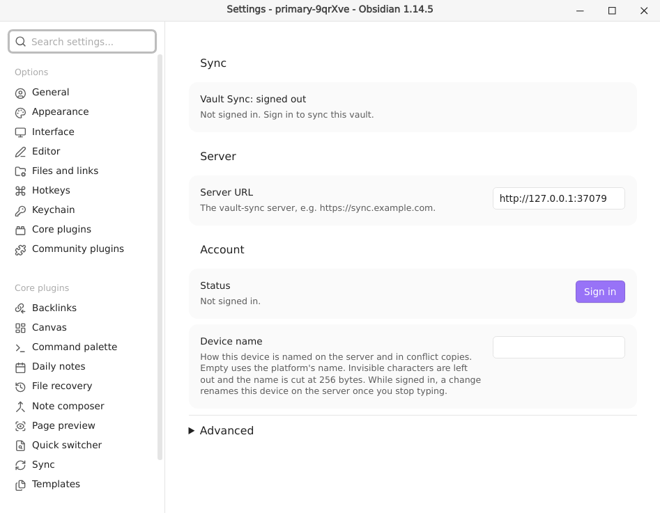
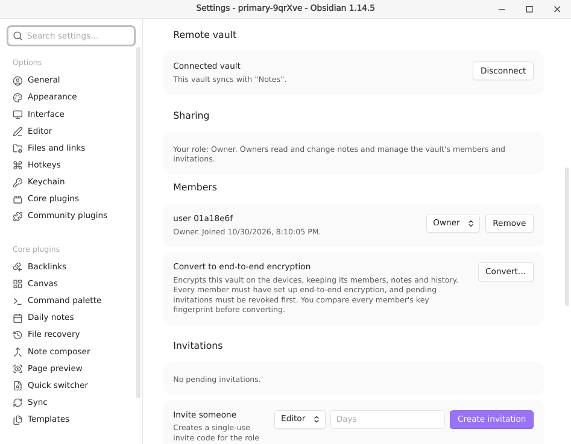

# Getting started

For: people who use the Obsidian plugin. You know Obsidian and how to install a community plugin. Your admin gave you the address of a vault-sync server.

This page shows how to install the plugin, sign in, connect a vault and start to sync. It ends with a tour of the settings tab.

## Install the plugin

vault-sync is not in Obsidian's list of community plugins yet. Install it with BRAT, a plugin that installs other plugins from GitHub:

1. In Obsidian, open **Settings → Community plugins**, then install and enable **BRAT**.
2. In BRAT's settings, add a beta plugin, and enter `solidDoWant/vault-sync`. BRAT downloads the plugin from the latest release of the project on GitHub.
3. Open **Settings → Community plugins** and enable **Vault Sync**.

Do these steps on each device that you want to sync.

## Enter the server address

Open **Settings → Vault Sync**. In **Server URL**, enter the address your admin gave you, for example `https://sync.example.com`. Usually this is the only thing that you enter.

The address must start with `https`. Plain `http` works only for `localhost`, `127.0.0.1` and `::1`, for local tests.

## Sign in

1. Click **Sign in** in the settings, or run the command **Vault Sync: Sign in**.
2. A dialog shows a link and a code. Open the link in any browser, on this device or on another one. On a phone, **Copy code** and **Open page** help.
3. Sign in on that page with your organization's login, and enter the code.
4. The dialog closes when the sign-in is complete.

If you close the dialog, the sign-in stops and nothing changes. If you refuse the request, or the code expires, the dialog tells you. Start again to get a new code.

You stay signed in until you sign out, or until your organization's login ends your session. Then the status shows **sign-in needed** (see [Troubleshooting](troubleshooting.md#sign-in-needed)). Your changes are kept, and sync continues when you sign in again.

**Sign out** stops sync. It also makes this device forget your sign-in and your unlocked encryption key. The connected vault and the device registration stay, so if you sign in again with the same account, sync continues.

## Connect a vault

Each Obsidian vault on your device syncs with one vault on the server. After you sign in, the **Remote vault** section offers three choices:

- **Connect to an existing vault** lists the vaults that you are a member of. Choose one to sync with it.
- **Create a vault** makes a new vault on the server, with you as its owner, and connects to it. Its name is the name of your Obsidian vault unless you change it. You can turn on **End-to-end encryption** here (see [Encryption](encryption.md)).
- **Join with an invite code** joins a vault that someone shared with you (see [Sharing](sharing.md#join-a-vault)).

The plugin syncs the whole Obsidian vault that it runs in. To keep a shared vault apart from your own notes, make a second Obsidian vault and connect that one.

End-to-end encrypted vaults cannot sync yet. You can create one, but you cannot connect to one. They are not in the list of existing vaults.

### When both sides already have files

If your Obsidian vault and the server vault both have files, the plugin asks before it connects. Then it combines them:

- A file that only one side has is copied to the other side.
- Nothing is deleted or overwritten.
- If both sides have a file at the same path with different content, the server's version stays at that path. Your version is kept next to it as a conflict copy, named `<name> (conflict <device> <date>).<ext>`.

### Disconnect

**Disconnect** stops sync for this vault. Your files stay. If you connect to the same vault again later, sync continues from where it stopped. If you change the server URL (you must sign out first), the vault is disconnected too.

## Your first sync

When you connect, the plugin registers this device and syncs at once. The status shows `syncing` and then `idle`. [Syncing](syncing.md) explains what syncs and when.

## The settings tab

Open **Settings → Vault Sync**. The sections are in the order that you set things up:

| Section | What it shows |
|---|---|
| **Sync** | The sync status. After this device was removed, **Register this device again** (see [Devices](devices.md)). |
| **Server** | **Server URL**. |
| **Account** | **Sign in**, **Sign out** or **Sign in again**, and **Device name** (see [Devices](devices.md#device-name)). |
| **End-to-end encryption** | While signed in: **Enable** or **Unlock** (see [Encryption](encryption.md)). |
| **Remote vault** | While signed in: the connected vault, or the choices to connect one. |
| **Sharing** | While a vault is connected: your role, and for owners the members and invitations (see [Sharing](sharing.md)). |
| **Devices** | While signed in: your devices (see [Devices](devices.md)). |
| **Advanced** | Settings that few people need. It stays open or closed on this device as you left it. |

Everything that you need to recover from a problem is outside **Advanced**: the status and its errors, **Sign in again**, **Unlock** and **Register again**.

**Advanced** holds:

- **OIDC issuer URL.** Leave it empty, and the plugin uses the login service that the server names. Fill it in only for a server too old to name one, or to fix the login service yourself. Enter it exactly, with any slash at the end. The plugin refuses an issuer that is different from the one the server names.
- **OIDC client ID.** Leave it empty unless your admin gives you one.
- **Rotate key** and **Re-encrypt history.** Shown to the owner of a connected end-to-end encrypted vault (see [Encryption](encryption.md#for-owners-of-an-encrypted-vault)).

While you are signed in, or while a sign-in runs, you cannot change the server URL or the two OIDC settings. Sign out first.

The plugin keeps its settings in `.obsidian/plugins/vault-sync/data.json`, which never syncs. It keeps your sign-in and your unlocked keys outside the vault folder, so a tool that backs up the vault folder, such as Git, never copies them.
